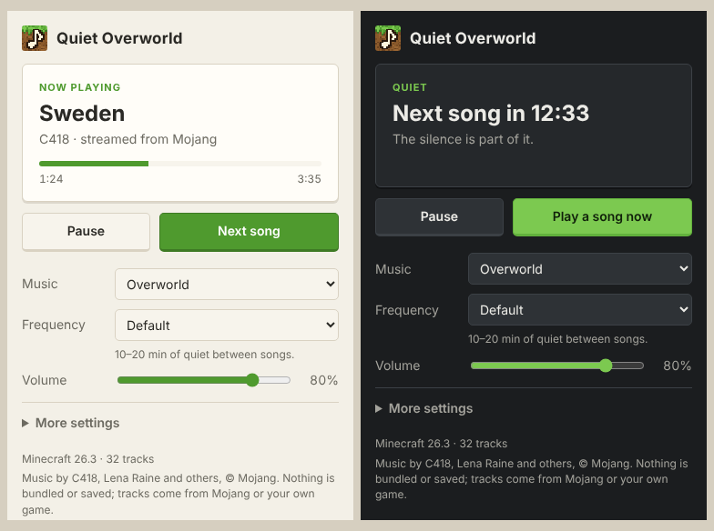

# Quiet Overworld

Minecraft with only the music part. A small app that plays Minecraft's background music the way the game does: a random
track from the overworld soundtrack, then ten to twenty minutes of quiet, then another. It lives in the system tray on
Windows, macOS and Linux. On phones it is a web page that keeps playing with the screen locked.



## Where the music comes from

The app ships with **no music**, and never saves any to disk. It finds the music the same way the game's own launcher
does:

1. **Your installed game.** If Minecraft: Java Edition is installed, tracks are played straight from its files. The
   official launcher's and Prism Launcher's folders are found automatically; others can be set under More settings.
2. **Mojang's servers.** Anything not installed is streamed from Mojang's official asset server
   (`resources.download.minecraft.net`) into memory, played, and dropped.
3. **Your own files.** Bought the soundtrack? Point "My own music folder" at it (`.ogg`, `.mp3`, `.flac`, `.wav`) and the
   app plays it with the same quiet in between.

Which tracks belong to which situation, their relative volumes and their titles are read from the game's own
`sounds.json` and language file. They are the same as in the game, and new tracks from game updates appear
automatically. Only that metadata (a few kB) is cached.

Minecraft's music is © Mojang Studios and its composers (C418, Lena Raine, Kumi Tanioka, Aaron Cherof, Amos Roddy,
fingerspit). This project is not affiliated with Mojang or Microsoft. It is meant for people who own the game; the
"Installed game only" source never touches the network at all.

## How it plays

The defaults copy the game exactly (`MusicManager` in Java Edition):

| | Game rule | In the app |
| --- | --- | --- |
| Music | Overworld survival music (`music.game`) in most biomes | **Overworld** (default) |
| First song | 5 seconds after start | 5 seconds after launch |
| Between songs | random 10–20 minutes in the overworld | same |
| Track choice | weighted random from the situation's list | same weights and per-track volumes |
| Music Frequency option | Default, Frequent (≤ 10 min), Constant (5 s) | same, plus Custom (your own range) |
| Changing situation | title screen and End music cut the current song; others let it finish | same |

Other situations can be picked from the **Music** menu: Creative mode, Underwater, every biome with its own music
(Meadow, Cherry Grove, Deep Dark, …), the Nether biomes, the End, the dragon fight, the credits and the title screen.
A specific game version can be chosen under **More settings** (for example an older release with only C418's music).

Under **Songs**, each song the chosen music can play has a checkbox, grouped by the update that added it ("Original
(1.0)", "Update Aquatic (1.13)", …). Pick an update and press **Check all** or **Uncheck all** to switch a whole group.
By default each kind of music plays its songs from the earliest update that had it: C418's original tracks in the
overworld.

Controls: **Pause** freezes the song or the countdown. **Play a song now** / **Next song** skips the wait or the current
track.

## Light on resources

- No music, browser engine or runtime is bundled. The app uses the OS webview (Tauri): the Linux installer is under
  4 MB, about 9 MB once installed.
- Closing the window **destroys** the webview instead of hiding it. In the tray only the small Rust process is left.
  Started with `--hidden` (as autostart does), it runs with no browser processes at all: about 12 MB of private memory
  in one process on Linux.
- Between songs nothing runs: no polling and no timers ticking 20 times a second. The engine sleeps until the next
  deadline. Measured on Linux: 0 CPU ticks over 30 s of quiet.
- On desktop the audio device is opened only while a song plays, and released between songs and while paused, so the
  app never keeps your computer awake.
- A streamed track (3–8 MB) is held in memory only while it plays.

## Platforms

| | Background | Notes |
| --- | --- | --- |
| Windows, macOS, Linux | System tray: play/pause, next, open, quit | Closing the window keeps the music going (can be turned off). Optional start at login. On macOS the Dock icon hides while only the tray icon is left. |
| Web (phones) | Lock-screen controls: play/pause, next | [acroath.github.io/Quiet-Overworld](https://acroath.github.io/Quiet-Overworld/). Tap play once; it keeps going with the screen locked. Only the latest release's music. |

On phones the music always streams from Mojang (Java Edition is not installable there).

## Install

**On a phone**, open [acroath.github.io/Quiet-Overworld](https://acroath.github.io/Quiet-Overworld/) and tap play.
Browsers only allow sound after a tap, so the first song starts 5 seconds after it. To keep a page playing with the
screen locked, phones need it to play sound the whole time, so the quiet between songs is played as silence. On an
iPhone the browser needs iOS 26 or newer (earlier versions cannot play the game's Ogg Vorbis files), and the volume
is set with the side buttons.

iPhone browsers all use Safari's engine, which refuses Mojang's files because the server labels them as plain data.
There the page plays them through a small relay ([relay/worker.js](relay/worker.js), a Cloudflare Worker) that passes
each file on labelled as audio and stores nothing. Add `?debug` to the address to see a log of what the player does.

**On a computer**, use the app:

CI builds installers on every push: open the latest successful [Build workflow
run](https://github.com/AcroAth/Quiet-Overworld/actions/workflows/build.yml) and download the artifact for your system
(`.msi`/`.exe`, `.dmg`, `.deb`/`.rpm`/`.AppImage`).

- The builds are not signed by a known developer. Windows SmartScreen warns the first time (More info → Run anyway).
  On macOS, open the app once, then allow it under System Settings → Privacy & Security → Open Anyway (or run
  `xattr -dr com.apple.quarantine "/Applications/Quiet Overworld.app"`).
- On Linux prefer the `.deb` or `.rpm` (under 4 MB). The `.AppImage` carries its own copy of the web engine and is
  around 80 MB. The tray needs `libayatana-appindicator3-1` (installed with the `.deb`). Most panels open the tray menu
  on click; use **Open Quiet Overworld** there.

## Build from source

You need [Rust](https://rustup.rs) (1.90+), Node.js 18+ and the [Tauri
prerequisites](https://v2.tauri.app/start/prerequisites/) for your OS. On Debian/Ubuntu:

```sh
sudo apt install libwebkit2gtk-4.1-dev libayatana-appindicator3-dev librsvg2-dev libxdo-dev libssl-dev libasound2-dev
```

Then:

```sh
npm install
npm run tauri dev      # run it
npm run tauri build    # installers in src-tauri/target/release/bundle
```

## How it's built

```
src/                     The window: plain HTML, CSS and JavaScript, no framework or bundler
  web.js                 the web version's engine, in place of the Rust backend (same commands and events)
src-tauri/src/
  catalog.rs             sounds.json → music situations, weights, volumes, titles
  sources.rs             Mojang's version manifest and asset server, installed game folders, music folders
  library.rs             picks the next track and fetches it; caches the catalog (metadata only)
  settings.rs            settings and the game's timing rules (Musics, MusicFrequency)
  engine.rs              the MusicManager port: deadlines, pause, skip, situation changes
  audio.rs               playback with rodio; opens the device only while needed
  tray.rs                tray icon, window lifecycle, autostart (desktop)
  history.rs             which update added each song; the default songs
data/song-history.json   the first release with each song, from scripts/song-history.mjs (monthly in CI)
relay/worker.js          the audio relay for iPhone browsers (Cloudflare Worker)
scripts/make_icon.py     draws the pixel-art icon
scripts/build-catalog.mjs
                         builds catalog.json for the web version (Mojang's metadata refuses web pages)
```

Settings live in the OS config folder (`settings.json`, e.g. `~/.config/io.github.acroath.quietoverworld/`), and the
cached catalog in the OS cache folder.

### Testing

```sh
cd src-tauri && cargo test
```

To try the whole app without Mojang's servers, point it at a local mirror with the same layout:

```sh
QUIET_OVERWORLD_MANIFEST_URL=http://127.0.0.1:8765/manifest.json \
QUIET_OVERWORLD_RESOURCES_URL=http://127.0.0.1:8765/res \
npm run tauri dev
```

## Not done yet

- No media-key controls in the desktop app (pause and next are in the window and the tray). The web page has
  lock-screen controls.
- The web page offers only the latest release's music, from Mojang's servers.
